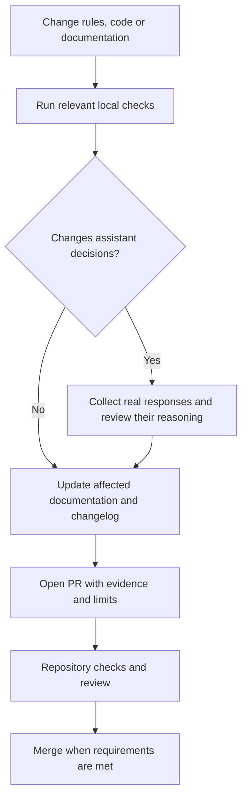

# Contributing to Green Codex

Thank you for helping improve Green Codex. Contributions should make the guidance clearer,
more evidence-based, and easier to apply across projects.

## Maintainers

The project is actively maintained by the **Green Codex Core Team** at the Institut du Numérique Responsable (INR):
- [@gridboy](https://github.com/gridboy) (Guillaume Gallon)
- [@bourgeoisguillaume01-glitch](https://github.com/bourgeoisguillaume01-glitch) (Guillaume Bourgeois)
- [@vincentcourboulay](https://github.com/vincentcourboulay) (Vincent Courboulay)

For a complete list, see [MAINTAINERS.md](MAINTAINERS.md).

## Workflow

1. Open an issue for a new rule, a correction, or a change with a broad impact.
2. Create a focused branch from `main`.
3. Edit the source skill and its references. Keep generated or local artefacts out of commits.
4. Run the relevant checks below. CI runs the full repository checks on the PR.
5. Open a Pull Request explaining the problem, the resulting behaviour, verification and limits.
   Update [CHANGELOG.md](CHANGELOG.md) under `Unreleased`; publishing a commit is not a release.

## Local verification

Run commands from the repository root with Python 3.10 or newer. The package tests use the
standard library; CI currently runs Python 3.11. Run the affected tests while editing, then
all of these before submitting changes to rules or scripts:

```sh
python3 green-codex/scripts/test_skill.py
python3 green-codex/scripts/test_sobriety.py
python3 green-codex/scripts/test_nr_summary.py
python3 green-codex/scripts/test_nr_hook.py
python3 green-codex/scripts/test_reference_catalog.py
python3 green-codex/scripts/test_evals.py
python3 green-codex/scripts/test_eval_review.py
python3 green-codex/scripts/check_sobriety.py --path .
bash scripts/test-release-version.sh
git diff --check
```

| Check | What it verifies |
| --- | --- |
| `test_skill.py` | Required package files and guidance |
| `test_sobriety.py` | The three static checks and their regression cases |
| `test_nr_summary.py` | Task records, reported findings and command exit statuses |
| `test_nr_hook.py` | Hook scope, summary fields, continuation limit and installer preservation |
| `test_reference_catalog.py` | Rule registration, unique definitions and source-question coverage |
| `test_evals.py` | Scenario structure and valid rule references, without calling a model |
| `test_eval_review.py` | Binding a semantic review to the saved response, scenario and run |

For workflow or site changes, also run `python3 scripts/check-metadata.py` with PyYAML
available. CI installs `cffconvert==2.0.0` and validates `CITATION.cff`; separate workflows
check spelling and Markdown links. See [the validation workflow](.github/workflows/validate.yml)
for the current commands. If the Codex skill validator is installed, also run:

```sh
python3 ~/.codex/skills/.system/skill-creator/scripts/quick_validate.py green-codex
```

Passing these checks does not show that an assistant applies the rules correctly. For changes
that affect its decisions, use [the behavioral evaluation procedure](evals/README.md) with real
responses and an independent review. Keep missing or partial evidence explicit.



In words: check the changed files, evaluate actual responses when decisions change, update the
documentation, and submit the evidence for review. CI validates the package; it does not replace
that review.

For hook changes, test the adapter first. Installation does not grant trust: follow the
[hook installation and verification guide](green-codex/references/closing-summary.md) for a
real host check after approval. Never bypass trust to make a test pass or claim activation
from unit tests alone. Ordinary package tests do not modify the user's hook configuration.

## Rule changes

Every new rule should identify its intended audience, avoid unverifiable claims, and cite the
source when it refers to an external framework or guide. Keep official acronyms unchanged.
State the trigger, concrete action and evidence needed. Reuse an existing rule for the same
requirement; preserve old IDs as documented aliases when necessary. Update source attribution,
reference coverage and evaluation scenarios when their scope changes.

## Commit messages

Apply the [expression and commit-message rules](green-codex/references/expression.md)
to authored prose. Before each commit, compare its message with the staged diff:
state the concrete change, its reason, actual verification and material limits.
Review the final merge or squash message with the same requirements.

## Pull Requests

One coherent change per PR is preferred. CI must pass and at least one CODEOWNER review is required
before merging. Do not include secrets, generated caches, personal data, or unrelated formatting.

## Licensing

By contributing, you agree that your contributions are distributed under the project licences:
Apache-2.0 for executable code and CC BY 4.0 for documentation and rule content, unless a file states
otherwise. BP-AIR, stakeholder maturity and RIA31 adaptations are CC BY-SA 4.0.
Keep their attribution and share-alike terms; do not relabel an adaptation as original content.
The token sobriety references inspired and adapted from Caveman are Apache-2.0;
preserve their copyright, modification notices and packaged third-party attribution.
See [reuse rights](green-codex/references/reuse-rights.md) before incorporating outside material.
