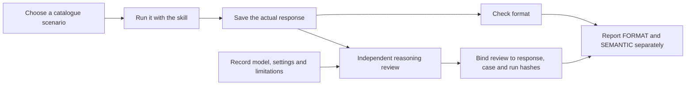

# Behavioral evaluations

The catalogue contains **33 scenarios**. A scenario is a test request, not a passing result.

The `three-u-pilot` scenario checks practical utility, actual adoption and
usability judgments from a small pilot, with errors, missing adoption criteria
and a keyboard blocker. It tests the skill's reasoning about supplied evidence,
not whether a real service satisfies the 3U.
See [the real paired responses and review](runs/2026-09-14-three-u/README.md):
candidate passes semantic review, while both answers fail literal rule-ID checks.

[The September 14 charter comparison](runs/2026-09-14-charter/README.md) records
two real paired samples and independent reviews. Both variants pass the semantic
checks; the candidate adds explicit charter rule traceability. Five other charter
scenarios remain unexecuted.

A first real response and its separate semantic review are recorded in
[the September 13 run](runs/2026-09-13-rebound/README.md). It covers one case,
with an honest lexical failure; it is not a full benchmark.

The cases in `cases.json` are realistic requests used to check whether Green Codex applies the
right rules, asks for evidence, and avoids universal technology or carbon claims.

Seven charter cases cover workplace rollout, agent security and oversight,
discrimination response, accessibility, lifecycle claims, unsupported certification
and proportionate scope. Each includes semantic review criteria. All ten new
`AI-CHARTER-*` rules must appear in at least one scenario. The non-AI scope control
has no required charter rule: testing must not force irrelevant advice.

Catalogue validation proves reference integrity and coverage by scenarios, not
that an agent passes those scenarios. Real responses and separate semantic reviews
are required to assess behaviour; application security and accessibility tests
still need to run on the actual system under review.

## What each verification layer proves

| Layer | Input | Result and boundary |
| --- | --- | --- |
| Catalogue validation | `cases.json` and rule references | Valid structure and IDs; no model is run |
| Script regression tests | Controlled fixtures | Script behaviour for those cases; no judgement of a real answer |
| Format evaluation | Saved real response | Expected IDs, terms and statuses; keywords do not prove reasoning |
| Semantic review | Response, case, run metadata and evidence | A named reviewer's assessment, bound to those exact inputs |
| NR hook | Current hook event and final answer | Summary fields are present; their claims are not authenticated |



In words: collect a real answer, check its format, review its reasoning, and bind that review
to the exact answer and run. A missing review stays `REVIEW_REQUIRED` even if format checks pass.
The [closing-summary guide](../green-codex/references/closing-summary.md) describes a separate
end-of-task check; a successful hook is not a semantic evaluation.

## Added NR scenarios

The eight scenarios added on 2026-10-17 cover:

| Scenario | Main decision being tested |
| --- | --- |
| `nr-charter-signature` | A signed charter alone does not demonstrate implementation |
| `air-reversibility` | An export/import trial provides evidence beyond a contract clause |
| `stakeholder-maturity-proof` | Current supplier practices need supporting evidence |
| `ria-source-and-risk` | Source provenance and AI risks require scoped checks |
| `source-reuse-rights` | Rewording does not remove licence obligations |
| `charter-language-node` | Apply Node.js checks without irrelevant browser requirements |
| `charter-natural-language-summary` | Keep text-only tasks proportionate and claims supported |
| `charter-host-capabilities` | Do not claim unavailable tools or human actions were performed |

Their presence and schema validation do not establish completed model evaluations.
Use the linked dated records and the files in `runs/` to identify actual saved responses and reviews;
manual walkthroughs without those artifacts are not benchmark results.

## Run an evaluation

For each case, run the prompt with the skill and save the response as
`evals/responses/<case-id>.md`. Then run:

```bash
python3 green-codex/scripts/run_evals.py \
  --responses evals/responses \
  --reviews /path/to/reviews.json \
  --run /path/to/run.json
```

Use actual metadata and reviews in those files, following the schema below. To run a subset,
add `--case nr-charter-signature` (repeat the option for other cases). The report states partial
coverage; do not describe it as a full run. Omitting `--reviews` or `--run` allows format inspection
but leaves semantic results unresolved and causes a nonzero exit status.

The evaluator always reports `FORMAT` and `SEMANTIC` separately. Default exit status
follows the independent semantic review bound to the exact response, case and run.
Missing or stale reviews remain `REVIEW_REQUIRED` even when keywords match. Supply
`--reviews reviews.json --run run.json`. Add `--strict-format` to require literal
identifiers, terms and statuses as well. Flagged substrings need interpretation,
including negated claims. Missing responses remain `REVIEW_REQUIRED`.
CI checks catalogue integrity and review binding, not unexecuted behaviour.

Each review is keyed by case ID and contains `reviewer`, `verdict`, `checks`,
`response_sha256`, `case_sha256` and `run_sha256`. Hash the UTF-8 response text
unchanged. Hash the case and run objects after serializing with Python
`json.dumps(value, sort_keys=True, ensure_ascii=False)`. Changing the model,
settings, date, limitations or skill hash invalidates the recorded review.

The run records `model`, `date`, `skill_sha256`, non-empty `settings` and a
`limitations` list. Each applicable review check records a boolean `passed`
and an `evidence` explanation. Reviews are attestations by the named reviewer;
hashes detect changed inputs, not whether a reviewer's judgment is correct.

These automated checks are lexical screening, not proof of correct reasoning. Review each response
against its `review_checks` when present, and check the actual recommendation, arithmetic, evidence
status and respect for scope. A response that merely repeats keywords must not pass semantic review.
The substring-based forbidden-term checks can also reject a correctly negated claim; inspect it.

For comparisons, run the same prompts against the baseline and revised skill with the same model,
tools and settings in fresh contexts. Save actual responses and record the model, date, loaded
references and limitations. Never fabricate responses to satisfy the evaluator. Keep catalogue
validation, lexical results and independent semantic review results separate in any report.

New lifecycle cases cover service necessity, older devices, rebound arithmetic, unsupported
compliance claims, muted autoplay, critical images, total AI task cost and safe retirement.

All 33 cases have specific semantic criteria, including no-change SQL, rare essential
services and compression trade-offs. Catalogue presence does not prove execution.
Historical results describe the evaluator at the time; `--strict-format` reproduces
its combined exit policy. Archived responses and run hashes remain unchanged.
